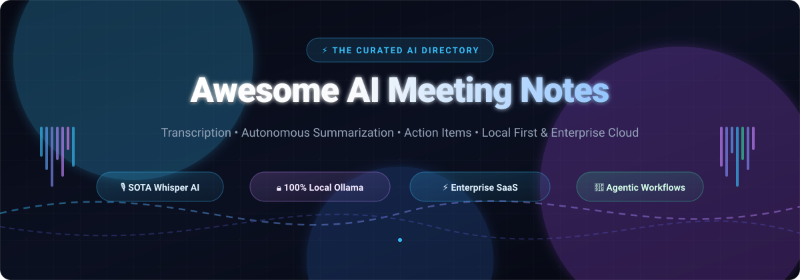
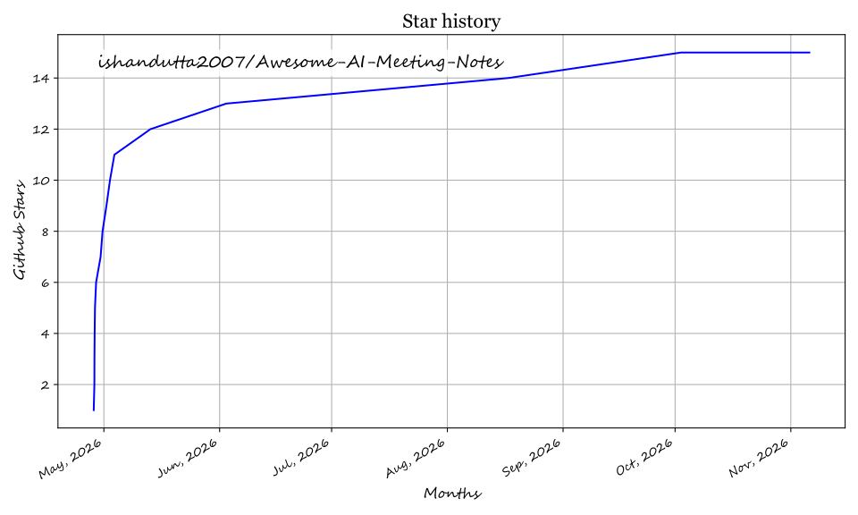

  

# 🎙️ Awesome AI Meeting Notes

> A curated list of the best AI-powered meeting transcription, summarization, voice-to-text, and note-taking tools.

 
 
  

---

## 🚀 Overview

This repository is the definitive directory for the **AI Meeting Notes and Voice Intelligence Ecosystem**. We index top-tier **SaaS platforms** and battle-tested **Open-Source projects** transforming how hybrid teams, developers, founders, and enterprises record, transcribe, index, and query meeting intelligence.

### ❓ Why Use AI for Meeting Notes? (SEO)

Leveraging **AI meeting assistants**, **speech-to-text (STT)** engines, and **automated transcription** tools enables teams to:
- **Save Time & Eliminate Note Fatigue**: Eliminate manual note-taking and skip re-watching hours of meeting recordings with automated executive summaries and timestamped chapters.
- **Boost Accuracy & Context**: Get industry-leading transcription accuracy using **OpenAI Whisper**, **WhisperX**, and state-of-the-art **Speaker Diarization (Pyannote)**.
- **Extract Autonomous Action Items**: Convert freeform voice discussions into structured tasks, follow-up emails, and Jira/Linear/Slack tickets via generative LLM pipelines.
- **Enforce Strict Privacy & Data Sovereignty**: Self-host local models with **Ollama (Llama 3, DeepSeek, Qwen)** and on-device Whisper inference so sensitive corporate conversations never leave your hardware.
- **Build Searchable Second-Brain Knowledge**: Connect meeting knowledge to enterprise CRMs (Salesforce, HubSpot) or local vector databases for natural-language multi-meeting Q&A.

---

## 📍 Table of Contents

- [📊 Sector Overview & Market Dynamics](#-sector-overview--market-dynamics)
- [☁️ SaaS Products](#️-saas-products)
- [📂 Open-Source GitHub Projects](#-open-source-github-projects)
  - [🏠 Self-Hosted Assistants](#-self-hosted-assistants)
  - [💻 Local Transcription & Dictation Tools](#-local-transcription--dictation-tools)
- [🛠️ Frameworks & APIs](#️-frameworks--apis)
- [💖 Support & Sponsorship](#-support--sponsorship)
- [🤝 How to Contribute](#-how-to-contribute)
- [⚖️ Disclaimer](#️-disclaimer)
- [📈 Star History](#-star-history)

---

## 📊 Sector Overview & Market Dynamics

The global AI meeting assistants and conversational intelligence market is valued between **$2.5B and $3.5B**, compounding at an aggressive **CAGR of ~25%–34%** toward an estimated **$15B–$30B+ by the early 2030s**. The space remains **moderately to highly fragmented** rather than winner-take-all: while Big Tech ecosystem giants (Microsoft Copilot, Google Gemini, Zoom AI Companion) dominate basic built-in call summaries, specialized pure-plays and privacy-first local tools sustain strong competitive moats through bot-free audio capture, niche vertical sales intelligence (e.g., Gong, Avoma), MCP agent integrations, and on-prem data sovereignty.

---

## ☁️ SaaS Products

The leading commercial platforms in AI transcription, executive meeting minutes, and revenue intelligence, sorted by company scale (valuation / annual revenue).

| Platform | Company Scale (Valuation / Revenue) | Free Tier / Trial Limit | Starting Tier Price | Best For |
| :--- | :--- | :--- | :--- | :--- |
| **[Granola](https://www.granola.so/)** ✍️ | **$1.5B Valuation** ($125M Series C) | **25 lifetime meetings** (all core features included, no credit card required) | $14/month (billed annually at $168/yr) or $18/mo monthly | Bot-free notes for founders & VCs on macOS/Windows |
| **[Fireflies.ai](https://fireflies.ai/)** 🔍 | **$1.0B Valuation** (~$10M–$11M ARR) | **800 minutes storage** lifetime + limited AI transcription credits forever | $10/seat/month (billed annually at $120/yr) or $18/mo monthly | Automated calendar integration, CRM sync & sales teams |
| **[Otter.ai](https://otter.ai/)** 🦦 | **$100M+ ARR** (~$320M funding facility) | **300 minutes/month** (up to 30 mins/conversation, 3 lifetime audio file imports) | $8.33/seat/month (billed annually at $100/yr) or $16.99/mo monthly | Real-time live transcription, team collaboration & slide capture |
| **[Notta.ai](https://www.notta.ai/)** 🌐 | **$100M–$250M Est. Valuation** (~$31.8M funding) | **120 minutes/month** (up to 3 mins real-time or 5 mins/file upload forever) | $8.17/seat/month (billed annually at $98/yr) or $13.49/mo monthly | Multilingual speech-to-text, bilingual meetings & audio imports |
| **[Fathom](https://fathom.video/)** 🎥 | **$73M+ Valuation** (~$30M ARR) | **5 AI summaries/month** forever (plus unlimited 100% free manual recording & transcriptions) | $16/seat/month (billed annually at $192/yr) or $19/mo monthly | Native Zoom, Google Meet & Microsoft Teams users |
| **[Avoma](https://www.avoma.com/)** 🚀 | **$15M–$22.6M Est. ARR** ($15M funding) | **14-day full free trial** (access to all conversation and revenue intelligence features) | $19/seat/month (billed annually at $228/yr) or $24/mo monthly | Full-lifecycle revenue intelligence, pipeline forecasting & deal coaching |
| **[tl;dv](https://tldv.io/)** 🕒 | **$4.5M Est. ARR** ($4.5M seed funding) | **10 AI summaries lifetime** + unlimited recording/transcription across Zoom/Meet/Teams forever | $18/seat/month (billed annually at $216/yr) or $25/mo monthly | Multi-meeting thematic synthesis, clipping video snippets & UX research |
| **[MeetGeek](https://www.meetgeek.ai/)** 📊 | **$2M+ ARR** (~$2.6M funding) | **5 hours recording/month** + 3 months transcript storage forever | $9.99/seat/month (billed annually at $120/yr) or $19/mo monthly | Meeting automation workflows, personalized tags & Zapier triggers |
| **[Jamie](https://www.meetjamie.ai/)** 🛡️ | **$1.3M–$2.4M Est. ARR** (Bootstrapped / Angel) | **10 meeting credits/month** (first 10 meetings free forever, no bot required) | €24/seat/month (billed annually at €288/yr) or €29/mo monthly | Bot-free privacy, in-room microphone audio capture & executive summaries |
| **[Clarity](https://adoptclarity.com/)** 💎 | **Early-Stage Seed** (Bootstrapped / Indie) | **7-day full access free trial** (unlimited macOS native recordings & follow-up drafts) | $20/seat/month (billed monthly or annually) | Founder-led sales calls, instant customer feedback categorization |
| **[QuillHub](https://quillhub.ai/en/desktop?utm_source=awesome-ai-meeting-notes&utm_medium=directory&utm_campaign=listing)** 🪶 | **Micro-SaaS** (Axevia Labs LLC) | **60 minutes on sign-up + 14-day desktop trial** (full access to system audio recording) | $6.66/month (billed semi-annually at $39.99/6-mo) or $9.99/mo monthly | Local bot-free system audio recording on Mac & Windows, MCP agent API |
| **[echo99](https://www.echo99.app/)** 🎙️ | **Free, no account** | Free | Bot-free, on-device |

*Prices based on starting paid tiers with annual commitment where available. [Back to top](#-awesome-ai-meeting-notes)*

---

## 📂 Open-Source GitHub Projects

Curated open-source meeting recorders, speech-to-text CLIs, and local AI note takers. Sorted by GitHub Stars_Count (descending).

### 🏠 Self-Hosted Assistants

Full control over your audio transcripts and meeting intelligence with 100% data sovereignty.

1. **[Meetily](https://github.com/Zackriya-Solutions/meetily)**  — 🍎 🪟 🐧 Top Choice. Local Whisper + Ollama AI meeting assistant. Zero cloud latency, native audio capture, no meeting bot required.
2. **[Screenpipe](https://github.com/screenpipe/screenpipe)**  — 🍎 🪟 🐧 24/7 continuous local screen and mic capture with automatic meeting detection; Whisper transcripts indexed for local AI agents and semantic search (Ollama).
3. **[Char (anarlog)](https://github.com/fastrepl/anarlog)**  — 🍎 🪟 Open-source Granola alternative for macOS and Windows. Bot-free meeting recording with structured markdown export.
4. **[Natively](https://github.com/Natively-AI-assistant/natively-cluely-ai-assistant)**  — 🍎 🪟 Free open-source meeting assistant, interview copilot, and note taker. Real-time transcription, local RAG, stealth mode, and BYOK.
5. **[Vexa](https://github.com/Vexa-ai/vexa)**  — 🐳 Open-source meeting transcription API for Google Meet, Microsoft Teams & Zoom. Auto-join bots, real-time WebSocket transcripts, and MCP server for AI agents.
6. **[Call.md](https://github.com/video-db/call.md)**  — 💻 Turn calls and meetings into live agent loops. Records, transcribes, and structures real-time AI intelligence into Markdown.
7. **[Minutes](https://github.com/silverstein/minutes)**  — 🍎 Local-first meeting and voice memo transcription tool designed so AI coding clients (Claude Code, Cursor) can query transcripts.
8. **[Pensieve](https://github.com/lukasbach/pensieve)**  — 🍎 🪟 Local-only desktop app for effortless meeting transcription, automatic audio indexing, and offline summaries.
9. **[Murmury](https://github.com/GianlucaBave/murmury)** 🧝 — Live call assistant: local Whisper (MLX) transcription, short answers from your own documents with your own AI key, floating window excluded from screen sharing. 🍎

### 💻 Local Transcription & Dictation Tools

Command-line utilities, lightweight menu bar apps, and self-hosted transcription pipelines.

1. **[Ghost Pepper](https://github.com/matthartman/ghost-pepper)**  — 🍎 100% private, on-device voice models for speech-to-text, fast voice dictation, and meeting transcription on macOS.
2. **[Amical](https://github.com/amicalhq/amical)**  — 🍎 🪟 Open-source, local-first AI dictation and voice note application powered by Whisper. Offline-capable rapid speech-to-text.
3. **[Muesli](https://github.com/Muesli-HQ/muesli)**  — 🍎 Agent-native local meeting transcription and dictation for macOS. An open-source Granola and WisprFlow alternative.
4. **[Biscotti](https://github.com/scosman/Biscotti)**  — 🍎 Free, privacy-first native meeting transcription app for macOS powered by Apple Silicon accelerated Whisper.
5. **[Meetscribe / Millet](https://github.com/pretyflaco/meetscribe)**  — 🪟 🐧 Fully local meeting transcription with Pyannote speaker diarization, AI summarization, and polished PDF meeting minutes output.
6. **[Meeting-Transcriber](https://github.com/pasrom/meeting-transcriber)**  — 🍎 Minimalist macOS menu bar app for background meeting audio recording and Whisper speech transcription.
7. **[AI-Powered-Meeting-Summarizer](https://github.com/AlexisBalayre/AI-Powered-Meeting-Summarizer)**  — 🐳 Gradio web interface connecting Whisper transcription with open-source LLM summarization.
8. **[Ownscribe](https://github.com/paberr/ownscribe)**  — 💻 CLI-based meeting transcription and diarization pipeline utilizing WhisperX.
9. **[Summeet](https://github.com/lyzgeorge/summeet)**  — 🐧 Full-stack FastAPI + Vue self-hosted meeting assistant for transcribing and summarizing multi-party meetings.

*Legend: 🍎 macOS \| 🪟 Windows \| 🐧 Linux \| 💻 CLI \| 🐳 Docker. [Back to top](#-awesome-ai-meeting-notes)*

---

## 🛠️ Frameworks & APIs

Build your own autonomous AI meeting agent using these foundations:
- **[Whisper](https://github.com/openai/whisper)** 🎙️ — SOTA speech-to-text model by OpenAI.
- **[whisper.cpp](https://github.com/ggerganov/whisper.cpp)** ⚡ — High-performance C/C++ port of Whisper with Apple Silicon and CUDA acceleration.
- **[Ollama](https://ollama.ai/)** 🦙 — Run local LLMs (Llama 3, Qwen, DeepSeek) for zero-cost offline meeting summarization.
- **[Pyannote-audio](https://github.com/pyannote/pyannote-audio)** 🗣️ — Neural speaker diarization toolkit for tracking who spoke when.
- **[LangGraph](https://github.com/langchain-ai/langgraph)** 🕸️ — Multi-agent framework for building complex meeting ingestion and action item delegation loops.
- **[Model Context Protocol (MCP)](https://modelcontextprotocol.io/)** 🔌 — Connect live meeting transcripts directly into agentic IDEs and LLM copilots.

*[Back to top](#-awesome-ai-meeting-notes)*

---

## 💖 Support & Sponsorship

Thank you for exploring and utilizing **Awesome AI Meeting Notes**! Keeping this ecosystem map up to date with fast-moving AI breakthroughs, emerging OSS projects, and changing SaaS pricing tiers requires continuous effort and research.

If you find this repository valuable:
- ⭐ **Star this repository** to help others discover it.
- 🍴 **Fork and contribute** new tools, benchmarks, and updates.
- 📢 **Share it** with your team, fellow developers, or on social channels.
- ☕ **Buy me a coffee / Sponsor**: If you'd like to support ongoing maintenance and new features, consider sponsoring via the [GitHub Sponsors Dashboard](https://github.com/sponsors/ishandutta2007).

  

---

## 🤝 How to Contribute

We welcome community contributions! Please read our [Contributing Guidelines](CONTRIBUTING.md) and [Code of Conduct](CODE_OF_CONDUCT.md).

1. 🍴 Fork the Repository.
2. 📝 Add your tool (SaaS or Open Source) following the established table / star-sorted list schema.
3. ✨ Ensure descriptions are objective, exact pricing & free-tier limits are provided, and badges are properly formatted.
4. 🚀 Submit your Pull Request!

---

## ⚖️ Disclaimer

*This list is community-curated for informational purposes. Inclusion does not imply endorsement. Always verify data privacy policies, audio consent laws (one-party vs. two-party consent jurisdictions), and enterprise compliance before recording meetings. AI-generated notes and action items should always be reviewed for hallucinations.*

---

  <b>Made with ❤️ for the Global AI & Open-Source Community</b> 
  <i>Show some love by starring the repository!</i> ⭐

## 📈 Star History

<a href="https://www.star-history.com/?repos=ishandutta2007%2FAwesome-AI-Meeting-Notes&type=date&legend=bottom-right">
 <picture>
   <source media="(prefers-color-scheme: dark)" srcset="https://api.star-history.com/chart?repos=ishandutta2007/Awesome-AI-Meeting-Notes&type=date&theme=dark&legend=bottom-right" />
   <source media="(prefers-color-scheme: light)" srcset="https://api.star-history.com/chart?repos=ishandutta2007/Awesome-AI-Meeting-Notes&type=date&theme=dark&legend=bottom-right" />
   
 </picture>
</a>

## ⭐ Star History

<a href="https://star-history.com/#ishandutta2007/Awesome-AI-Meeting-Notes&Timeline" align="center">
  <picture>
    <source media="(prefers-color-scheme: dark)" srcset="assets/ishandutta2007_Awesome-AI-Meeting-Notes_growth.svg">
    
  </picture>
</a>
